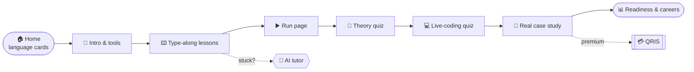

<div align="center">


<a href="https://github.com/sr464a6/ngodink">
  
</a>

<br/>


</div>

---

## `> whoami`

**ngodink** is a web app for people who want to learn programming without just watching hours of video tutorials. You read a short lesson, **type the code yourself**, run it in the page, take a quiz, and finish with a **case study from a real company problem**.

Think of it as a study tracker for coding: it shows how ready you are for each language and which careers fit you best.

---

## `> features`

| | Feature | What it does |
|---|---|---|
| 🃏 | **Language cards** | Home page shows every language as a 2-column card grid. Tap a card to enter that course. |
| 📖 | **Intro + tools** | Each course starts with what the language is for, plus the frameworks and tools around it. |
| ⌨️ | **Type-along lessons** | Step-by-step material where you type the code yourself, then hit a built-in **Run** page. |
| 🧠 | **Quizzes** | Theory questions and **live-coding** challenges with real case studies. |
| 🏢 | **Real-world case studies** | Problems taken from real company situations, not toy examples. |
| 🤖 | **AI tutor** | Don't know a term? Ask the AI right while reading. It addresses you by your account name. |
| 📊 | **Readiness meter** | Per-language progress gauge plus a career-fit indicator on the home page. |
| 💼 | **Job board** | Per-language job listings that link out of the app. |
| 💳 | **QRIS payments** | Premium content (lessons + real-world quizzes) unlocks per language for **Rp20.000 / month**. |
| 📢 | **Ads (reading only)** | Ads appear while reading, never during quizzes. |
| 🔐 | **Login** | Google / iCloud or email + password with email OTP. *(Currently bypassed for development.)* |

---

## `> how it flows`



---

## `> tech stack`

| Layer | Tech | Why it's here |
|---|---|---|
| **Backend** | **Go** | Fast, one compiled binary, trivial to deploy, and the app is a good excuse to practice Go. |
| **HTTP server** | `net/http` *(TODO: swap if you use Gin/Fiber/Echo)* | Routes pages and API endpoints with almost no dependencies. |
| **Frontend** | HTML + CSS + vanilla JS *(TODO: adjust)* | Lightweight pages, rounded bubble font, iPhone-like precise layout, blue/black/gray theme. |
| **Code runner** | Server-side sandboxed execution *(TODO: confirm)* | Powers the "Run" page so lessons can be executed in the browser. |
| **AI tutor** | LLM API *(TODO: name the provider)* | Explains terms in context while you read. |
| **Payments** | **QRIS** via a payment gateway | Indonesian users pay Rp20.000/month per language with any e-wallet or banking app. |
| **Auth** | Google / iCloud OAuth + email OTP | Fast sign-in with a verified identity. |
| **Database** | *(TODO: e.g. SQLite / Postgres)* | Stores progress, quiz results, and subscriptions. |
| **Hosting** | Free-tier host *(TODO: fill in)* | Keeps the project at zero cost while in development. |

---

## `> run it`

<details open>
<summary><b>⚡ Quick start (3 steps)</b></summary>

<br/>

**Requirements:** [Go 1.21+](https://go.dev/dl/) and Git.

```bash
# 1. clone
git clone https://github.com/sr464a6/ngodink.git
cd ngodink

# 2. install dependencies
go mod tidy

# 3. run
go run .
```

Open **http://localhost:8080** in your browser. *(TODO: change the port if different.)*

</details>

<details>
<summary><b>🔑 Environment variables</b></summary>

<br/>

Create a `.env` file in the project root:

```env
PORT=8080
AI_API_KEY=your_key_here
PAYMENT_API_KEY=your_gateway_key_here
SESSION_SECRET=any_long_random_string
```

*(TODO: match these to the names your code actually reads.)*

</details>

<details>
<summary><b>📦 Build a single binary</b></summary>

<br/>

```bash
go build -o ngodink .
./ngodink
```

</details>

---

## `> project map`

```text
ngodink/
├── main.go          # entry point & routes
├── handlers/        # page + API handlers      (TODO: verify)
├── templates/       # HTML pages               (TODO: verify)
├── static/          # CSS, JS, fonts, images   (TODO: verify)
├── go.mod
└── README.md
```

---

## `> roadmap`

- [x] Language card home page
- [x] Type-along lessons + run page
- [ ] Quiz engine (theory + live coding)
- [ ] Real-world case studies
- [ ] AI tutor
- [ ] QRIS subscription per language
- [ ] Job board
- [ ] Re-enable Google / iCloud / email OTP login

---

<div align="center">

Built by **[@sr464a6](https://github.com/sr464a6)** · type more, watch less 🚀


</div>
